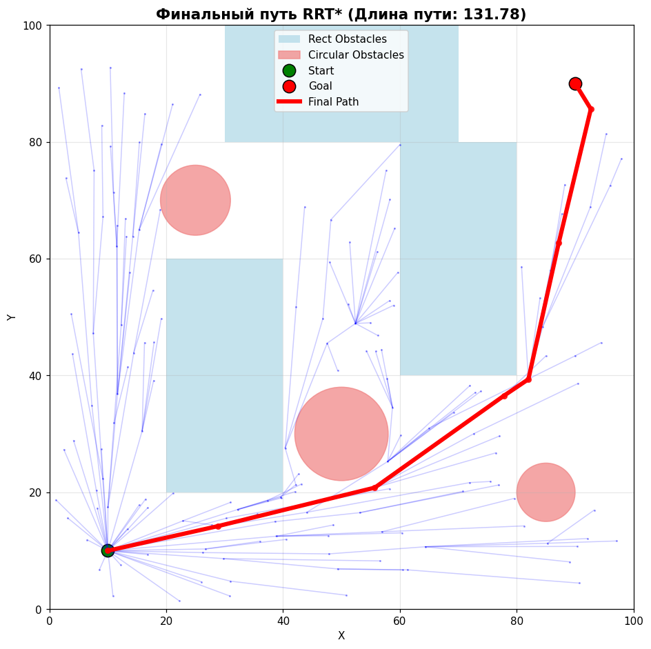
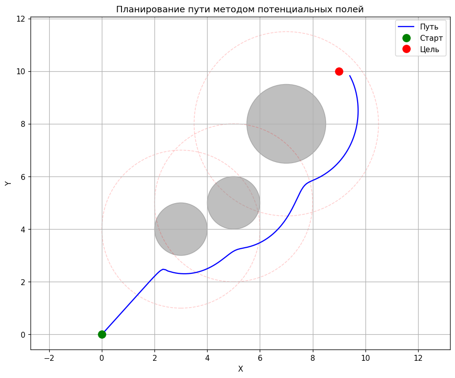
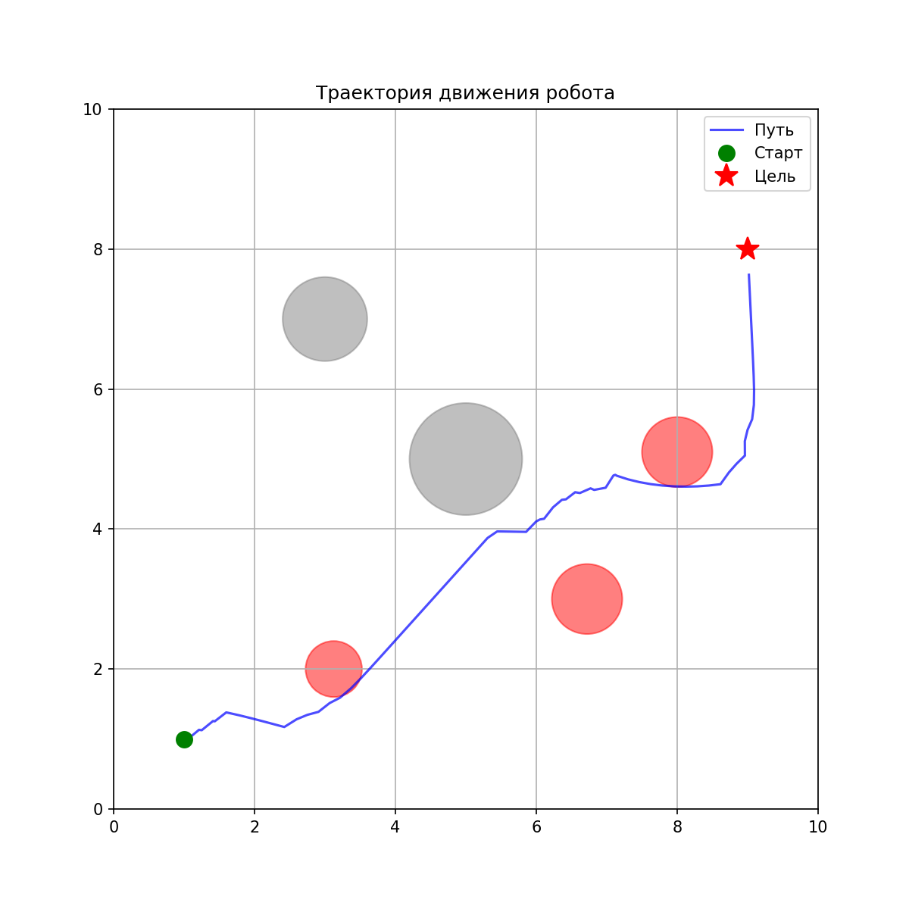
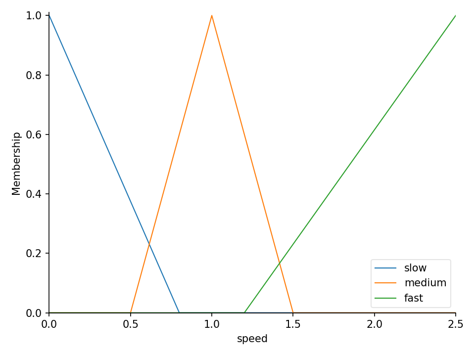

# Mobile Robot Path Planning and Control

[Русская версия](README.md)

Lab assignments for the course "Control of Intelligent Robots and Robotic Systems" (September–December 2025). They cover classic path search, artificial potential fields, fuzzy control, RRT/RRT* and a genetic algorithm in Python. Some of the labs were done in a team.

## Labs

| # | Files | Contents |
|---|---|---|
| 1 | `laba_1.py` | Global minimum search for Mishra's Bird function in a circular area. Rays from the center give candidates (points where the derivative changes sign), followed by coordinate-wise gradient descent with a decaying step. 3D plot in Plotly |
| extra | `cities.py` | Dijkstra on a weighted graph: the city that can reach the fewest other cities within a distance threshold |
| 2 | `laba_2/astar.py`, `laba_2/deikstra.py` | First version: grid A* with an interactive pygame visualization and Dijkstra on a graph with the shortest path drawn via networkx |
| 2 | `laba_2_A.py` … `laba_2_E.py` | Grid path search with rectangular and circular obstacles: Dijkstra, A* (Manhattan and Euclidean heuristics), a simplified D* Lite. Comparison by time and number of visited cells |
| 3 | `laba_3/A.py` | Artificial potential fields: attraction to the goal, repulsion from obstacles within an influence zone |
| 4 | `laba_4.py`, `laba_4_b.py` | A fuzzy controller in scikit-fuzzy: from the left, front and right distances and the angle to the goal it chooses the turn and the speed. `laba_4_b.py` adds 11 rules, parameter adaptation and a motion animation |
| 5 | `laba_5/A.py`, `B.py`, `C.py`, `rrt_animation.py` | RRT and RRT* (best-parent choice and rewiring), rectangular and circular obstacles, tree growth animation. `rrt_animation.py` (January 2026) shows the tree growing in real time or saves it as a GIF |
| 6 | `laba_6.py` | A genetic algorithm for Himmelblau's function: selection, crossover, mutation, interactive convergence plots in Plotly |

## Run results

Lab 2 on a 50 × 50 map (`medium` setup), path from (5, 5) to (45, 45):

| Algorithm | Visited cells | Path cost |
|---|---|---|
| Dijkstra | 1914 | 63.6 |
| A*, Manhattan heuristic | 803 | 63.6 |
| A*, Euclidean heuristic | 515 | 63.6 |

All three find a path of the same cost, but A* with the Euclidean heuristic visits almost 4 times fewer cells.

<table>
  <tr>
    <td></td>
    <td></td>
  </tr>
  <tr>
    <td align="center">RRT*: search tree and final path (lab 5)</td>
    <td align="center">Artificial potential fields (lab 3)</td>
  </tr>
  <tr>
    <td></td>
    <td></td>
  </tr>
  <tr>
    <td align="center">Fuzzy controller: robot trajectory among obstacles (lab 4)</td>
    <td align="center">Membership functions for speed (lab 4)</td>
  </tr>
</table>

Plot labels are in Russian, as in the original labs.

## Tech stack

Python, NumPy, Matplotlib, Plotly, scikit-fuzzy, pygame, networkx.

## Quick start

```bash
pip install -r requirements.txt
python laba_3/A.py
python laba_5/C.py
python laba_2/astar.py   # LMB: start, goal and walls; RMB: erase; Space: search; C: clear
```

`laba_2_E.py` holds the classes and a comparison harness without an entry point:

```bash
python -c "from laba_2_E import PathPlanningBenchmark as B; b = B(50, 50); b.setup_test_environment('medium'); b.run_benchmark((5, 5), (45, 45), algorithms=['dijkstra', 'astar'])"
```

## License

[MIT](LICENSE)
