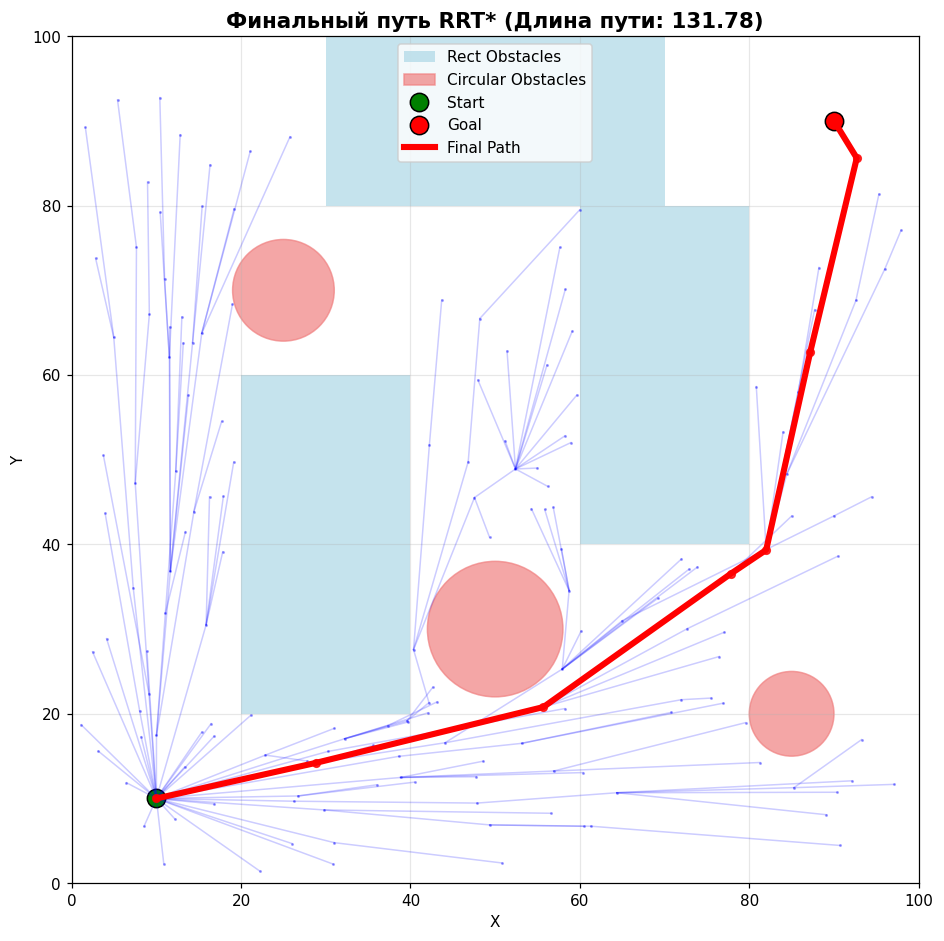
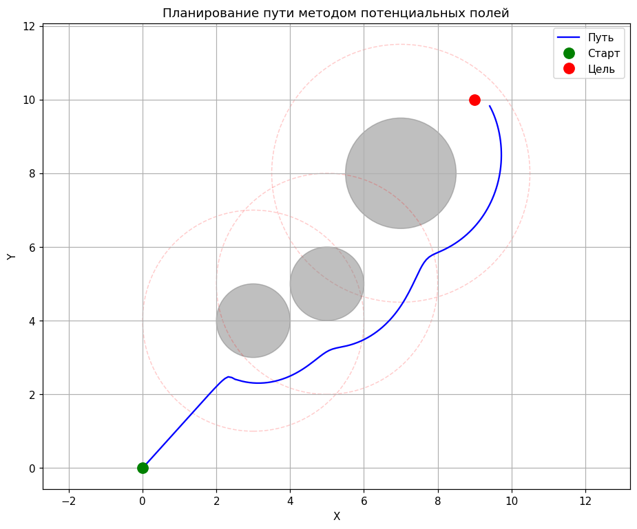
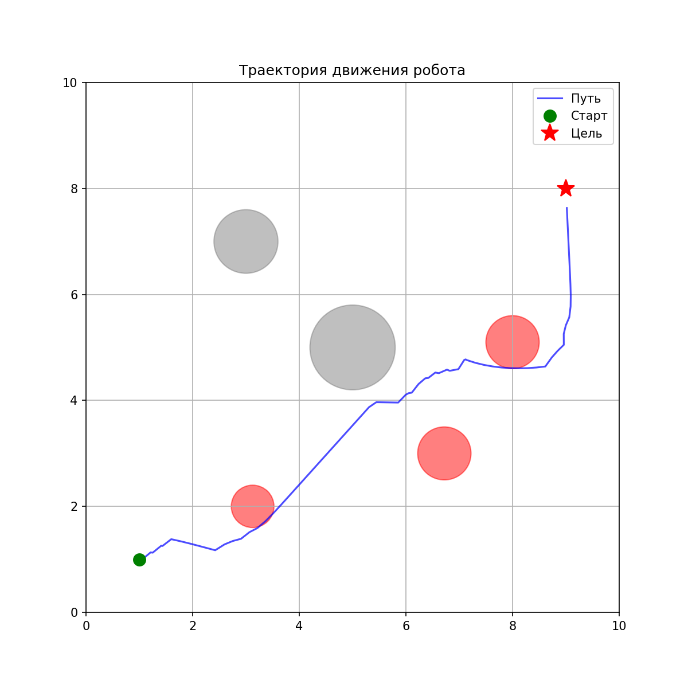
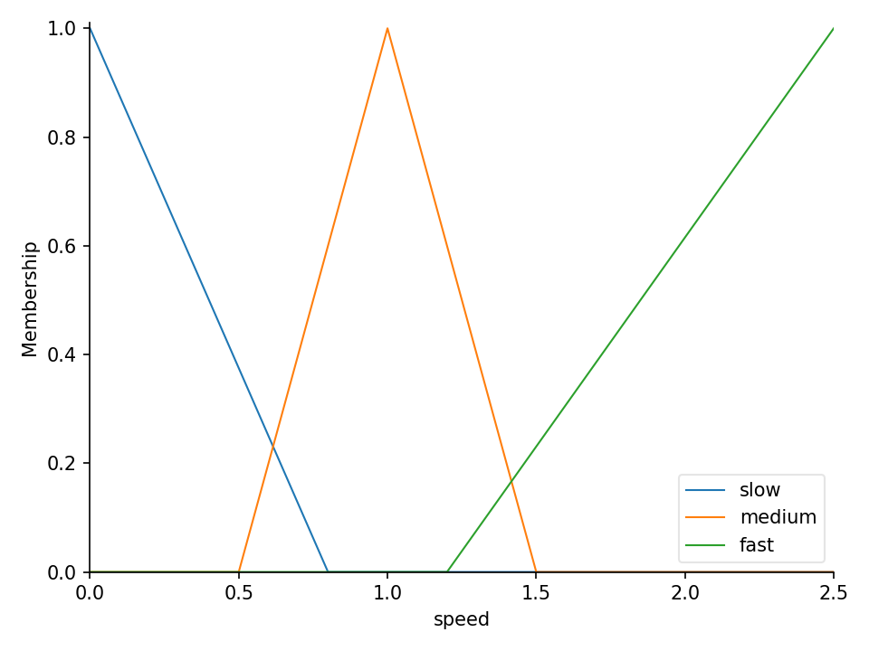

# Планирование пути и управление мобильным роботом

[English version](README.en.md)

Лабораторные по курсу «Управление интеллектуальными роботами и робототехническими системами» (сентябрь–декабрь 2025). Внутри классический поиск пути, метод потенциальных полей, нечёткое управление, RRT/RRT* и генетический алгоритм на Python. Часть работ выполнялась в команде.

## Лабораторные

| № | Файлы | Что внутри |
|---|---|---|
| 1 | `laba_1.py` | Поиск глобального минимума функции Mishra's Bird в круглой области. Лучи из центра дают кандидатов (точки смены знака производной), дальше покоординатный градиентный спуск с затухающим шагом. 3D-график в Plotly |
| доп. | `cities.py` | Дейкстра на взвешенном графе: город, из которого в пределах заданного расстояния достижимо меньше всего других городов |
| 2 | `laba_2/astar.py`, `laba_2/deikstra.py` | Первая версия: A* на сетке с интерактивной визуализацией в pygame и Дейкстра на графе с отрисовкой кратчайшего пути в networkx |
| 2 | `laba_2_A.py` … `laba_2_E.py` | Поиск пути на сетке с прямоугольными и круглыми препятствиями: Дейкстра, A* (манхэттенская и евклидова эвристики), упрощённый D* Lite. Сравнение по времени и числу просмотренных клеток |
| 3 | `laba_3/A.py` | Метод потенциальных полей: притяжение к цели, отталкивание от препятствий внутри зоны влияния |
| 4 | `laba_4.py`, `laba_4_b.py` | Нечёткий регулятор на scikit-fuzzy: по расстояниям слева, спереди и справа и по углу на цель выбирает поворот и скорость. В `laba_4_b.py` 11 правил, адаптация параметров и анимация движения |
| 5 | `laba_5/A.py`, `B.py`, `C.py`, `rrt_animation.py` | RRT и RRT* (выбор лучшего родителя и перестройка дерева), прямоугольные и круглые препятствия, анимация роста дерева. `rrt_animation.py` (январь 2026) показывает рост дерева в реальном времени или сохраняет его в GIF |
| 6 | `laba_6.py` | Генетический алгоритм для функции Химмельблау: селекция, кроссовер, мутация, интерактивные графики сходимости в Plotly |

## Прогон

Лабораторная 2 на карте 50 × 50 (вариант `medium`), путь из (5, 5) в (45, 45):

| Алгоритм | Просмотрено клеток | Стоимость пути |
|---|---|---|
| Дейкстра | 1914 | 63,6 |
| A*, манхэттенская эвристика | 803 | 63,6 |
| A*, евклидова эвристика | 515 | 63,6 |

Все три находят путь одной стоимости, но A* с евклидовой эвристикой просматривает почти в 4 раза меньше клеток.

<table>
  <tr>
    <td></td>
    <td></td>
  </tr>
  <tr>
    <td align="center">RRT*: дерево поиска и итоговый путь (лабораторная 5)</td>
    <td align="center">Метод потенциальных полей (лабораторная 3)</td>
  </tr>
  <tr>
    <td></td>
    <td></td>
  </tr>
  <tr>
    <td align="center">Нечёткий регулятор: траектория робота среди препятствий (лабораторная 4)</td>
    <td align="center">Функции принадлежности для скорости (лабораторная 4)</td>
  </tr>
</table>

## Стек

Python, NumPy, Matplotlib, Plotly, scikit-fuzzy, pygame, networkx.

## Запуск

```bash
pip install -r requirements.txt
python laba_3/A.py
python laba_5/C.py
python laba_2/astar.py   # ЛКМ: старт, цель и стены; ПКМ: стереть; пробел: поиск; C: очистить
```

`laba_2_E.py` содержит классы и стенд для сравнения без точки входа:

```bash
python -c "from laba_2_E import PathPlanningBenchmark as B; b = B(50, 50); b.setup_test_environment('medium'); b.run_benchmark((5, 5), (45, 45), algorithms=['dijkstra', 'astar'])"
```

## Лицензия

[MIT](LICENSE)

---

<sub>Код написан с октября 2025 по январь 2026, на GitHub выложен в ноябре 2026. Даты коммитов взяты по датам исходных файлов, README и иллюстрации добавлены при выгрузке.</sub>
